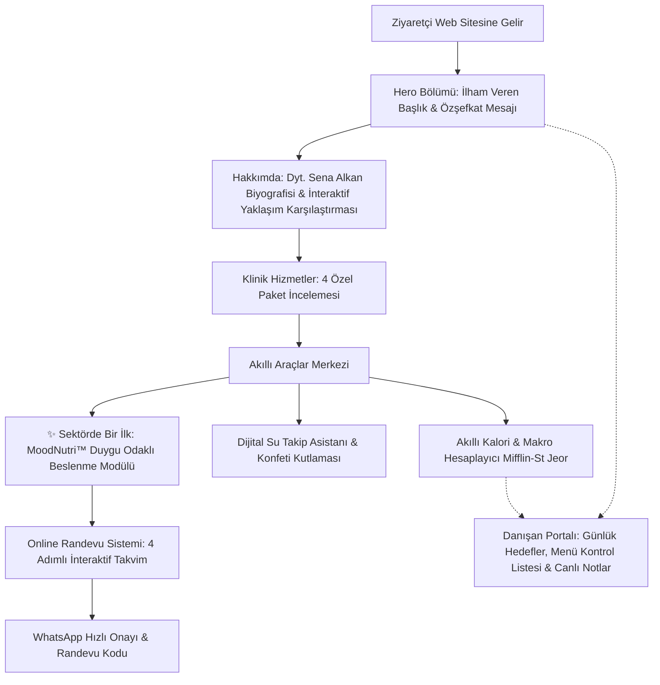

# 🥑 Dyt. Sena Alkan - Bütünsel Beslenme & MoodNutri™ Kliniği

> **"Diyet listelerine mahkum olmadan, bedeninle barışık, kalıcı ve şefkatli bir beslenme dönüşümü."**

Bu proje, bir klinik diyetisyen için son derece modern, ilham verici, güven veren ve etkileşimli bir web sitesi platformudur. Klasik kısıtlayıcı diyet anlayışını yıkarak; hormon dengesi, hücresel biyokimya, duygu durum yönetimi ve özşefkat ilkelerini temel alır.

Proje, **TypeScript** ve **React (Vite)** mimarisiyle geliştirilmiş olup, **GitHub Pages** üzerinden tek tıkla veya GitHub Actions ile otomatik yayına alınabilecek şekilde yapılandırılmıştır.

---

## 🎯 Projenin Temel Akışı (User Journey & Flow)



### 1. Ziyaretçi Karşılama (Hero Bölümü)
- Ziyaretçiyi kısıtlayıcı şok diyetlerden uzaklaştıran, suçluluk duygusunu sonlandıran sıcak bir dil.
- 1.250+ sağlıklı danışan, %96 alışkanlık koruma oranı, 8+ yıl klinik deneyim metrikleri.
- Günün Farkındalığı rozeti ve interaktif yönlendirme butonları.

### 2. Bilimsel & Empatik Hikaye (Hakkımda & Yaklaşımım)
- Dyt. Sena Alkan’ın Hacettepe Üniversitesi ve İngiltere Fonksiyonel Tıp eğitimi geçmişi.
- **İnteraktif Karşılaştırma Modülü**: *Eski Usul Kısıtlayıcı Şok Diyetler vs. Bütünsel & Sezgisel Yaklaşımımız*.

### 3. Kişiye Özel Danışmanlık Paketleri (Hizmetler)
- Sürdürülebilir Kilo Yönetimi & Sezgisel Beslenme
- Fonksiyonel Beslenme & Bağırsak Sağlığı (İBS, Eliminasyon, İnsülin Direnci)
- Sporcu Beslenmesi & Vücut Kompozisyonu
- MoodNutri™ Duygu & Zihin Odaklı VIP Beslenme

### 4. Akıllı Araçlar Merkezi (Interactive Hub)
- **Akıllı Kalori ve Makro Hesaplayıcı**: Yaş, cinsiyet, boy, kilo, aktivite seviyesi ve hedefe göre Mifflin-St Jeor formülüyle anlık BMR, TDEE, hedef kalori ve gram/yüzde bazında makro (protein, karbonhidrat, sağlıklı yağ) dağılımı. Sonuçlar tek tıkla Danışan Paneline aktarılabilir.
- **Dijital Su Takip Asistanı**: Kullanıcının kilosuna göre günlük ideal su hedefini belirleme, görsel animasyonlu su şişesi dolum efekti, tek tıkla bardak/kupa/matara ekleme (+250ml, +330ml, +500ml), localStorage kalıcılığı ve %100 hedefe ulaşıldığında konfeti patlaması (`canvas-confetti`).

### 5. Sektörde Bir İlk (USP): MoodNutri™ Modülü
- Danışanların yeme davranışlarının %80'ini yöneten duygu durumlarına odaklanan yenilikçi sistem.
- 6 Duygu Durumu Seçimi:
  1. 🧘‍♀️ **Stresli & Gergin** (Kortizol ve sinir sistemi dengeleyici)
  2. ⚡ **Yorgun & Enerjisiz** (Mitokondri ve kan şekeri toparlayıcı)
  3. 🍩 **Tatlı Krizinde** (Dopamin ve insülin yönetimi)
  4. 🌀 **Duygusal Açlık** (Fiziksel vs duygusal açlık skalası & H.A.L.T. kontrolü)
  5. 🧠 **Zihinsel Sis & Odaklanma** (Nöro-beslenme ve omega-3 desteği)
  6. 🌱 **Şişkinlik & Gaz** (Bağırsak-mikrobiyota yatıştırıcı)
- Her duygu için: Biyokimyasal neden analizi, tüketilmesi gerekenler, kaçınılması gerekenler, 5 dakikalık acil tarif kartı ve 30 saniyelik mindful nefes egzersizi.

### 6. Online Randevu Sistemi (Stepped Booking Modal)
- **Adım 1**: Program seçimi (Kilo yönetimi, fonksiyonel tıp, sporcu, MoodNutri vb.)
- **Adım 2**: Seans şekli (Online Görüntülü vs. Suadiye Kliniği Yüz Yüze) ile interaktif tarih ve saat slotu seçimi.
- **Adım 3**: Danışan iletişim bilgileri ve sağlık hedefi notu.
- **Adım 4**: Otomatik üretilen Takip Kodu (Örn: `#DNA-2026-8492`), randevu özeti ve tek tıkla WhatsApp hızlı onay yönlendirmesi.

### 7. Danışan Portalı (Portal Demo Deneyimi)
- Navbar veya mobilden açılan gerçekçi danışan paneli görünümü.
- Kilo takip grafiği (Başlangıç 72.4 kg ➔ Güncel 68.8 kg, -3.6 kg yağ kaybı).
- Günlük kalori ve su hedef barları.
- İnteraktif günlük öğün menüsü (Kahvaltı, Öğle, İkindi, Akşam için "Yedim ✓" onay kutuları).
- Dyt. Sena Alkan’ın canlı koçluk notu ve diyetisyene hızlı soru sorma formu.

### 8. Danışan Yorumları & Başarı Hikayeleri
- Gerçek danışanların öncesi/sonrası kazanımları (tartı değil; kan tahlilleri, enerji artışı ve yeme özgürlüğü).
- Kategori bazlı filtreleme butonları.

### 9. SSS & İletişim
- Açılır/kapanır akordeon sıkça sorulan sorular.
- İletişim formu, WhatsApp doğrudan erişimi, klinik açık adresi ve çalışma saatleri.

---

## 🚀 GitHub Pages Üzerinden Yayına Alma Rehberi

Bu proje GitHub Pages ile %100 uyumludur. `frontend/vite.config.ts` içinde `base: './'` tanımlandığı için tüm JavaScript, CSS ve görseller görece yollarla sorunsuz çalışır.

### Yöntem A: GitHub Actions ile Otomatik Dağıtım (Önerilen)

Projeye `.github/workflows/deploy.yml` dosyası eklenmiştir. Tek yapmanız gereken kodları GitHub reposuna göndermektir:

1. Projeyi bir GitHub reposuna push edin:
   ```bash
   git add .
   git commit -m "feat: Diyetisyen web sitesi ve MoodNutri modulu"
   git branch -M main
   git remote add origin https://github.com/<kullanici-adiniz>/<repo-adiniz>.git
   git push -u origin main
   ```

2. GitHub repository sayfanıza gidin:
   - **Settings** ➔ **Pages** sekmesine tıklayın.
   - **Build and deployment** başlığı altındaki **Source** kısmını **GitHub Actions** olarak seçin.
   - GitHub Actions otomatik olarak `frontend` klasörünü derleyecek ve sitenizi `https://<kullanici-adiniz>.github.io/<repo-adiniz>/` adresinde canlıya alacaktır.

---

### Yöntem B: `gh-pages` Paketi ile Manuel Dağıtım

İsterseniz komut satırından tek bir komutla da yayına alabilirsiniz:

1. `frontend` dizinine geçin:
   ```bash
   cd frontend
   ```
2. Dağıtım komutunu çalıştırın:
   ```bash
   npm run deploy
   ```
   *Bu komut önce TypeScript derlemesini ve `vite build` işlemini yapar, ardından oluşan `dist` klasörünü GitHub reponuzdaki `gh-pages` dalına yükler.*

3. GitHub repository sayfanızda **Settings** ➔ **Pages** sekmesinden Branch olarak **`gh-pages` / `root`** seçerek kaydedin.

---

## 🛠️ Yerel Ortamda Çalıştırma

Projeyi bilgisayarınızda yerel olarak çalıştırmak için:

```bash
# Frontend dizinine gidin
cd frontend

# Bağımlılıkları yükleyin
npm install

# Geliştirici sunucusunu başlatın
npm run dev
```

Tarayıcınızda açılan adrese (genellikle `http://localhost:5173`) giderek web sitesini inceleyebilirsiniz.

---

## 📂 Proje Dizin Yapısı

```
diyetisyen/
├── .github/
│   └── workflows/
│       └── deploy.yml         # GitHub Actions otomatik dağıtım iş akışı
├── frontend/
│   ├── public/                # Statik varlıklar ve görseller
│   │   ├── dietitian.jpg      # Diyetisyen portresi
│   │   └── healthy_bowl.jpg   # Bütünsel sağlıklı kase görseli
│   ├── src/
│   │   ├── components/        # Modüler UI bileşenleri
│   │   │   ├── About.tsx
│   │   │   ├── AppointmentModal.tsx
│   │   │   ├── ClientPortalModal.tsx
│   │   │   ├── FAQSection.tsx
│   │   │   ├── Footer.tsx
│   │   │   ├── Hero.tsx
│   │   │   ├── MoodNutri.tsx
│   │   │   ├── Navbar.tsx
│   │   │   ├── Services.tsx
│   │   │   ├── SmartTools.tsx
│   │   │   └── Testimonials.tsx
│   │   ├── data/
│   │   │   └── contentData.ts # Tüm UX metinleri, MoodNutri & formül motoru
│   │   ├── types/
│   │   │   └── index.ts       # TypeScript arayüz tanımları
│   │   ├── App.tsx            # Ana uygulama bileşeni
│   │   ├── index.css          # Tasarım sistemi & dark/light tema
│   │   └── main.tsx           # React giriş noktası
│   ├── index.html             # SEO meta etiketleri ve Google Fonts
│   ├── package.json           # Bağımlılıklar ve derleme scriptleri
│   ├── README.md              # Frontend teknik dökümantasyonu ve işlem notları
│   └── vite.config.ts         # Vite yapılandırması (base: './')
├── backend/                   # Gelecekteki API geliştirmeleri için ayrılmış dizin
└── README.md                  # Genel proje akışı ve yayına alma rehberi
```

---

## 🩺 Yasal Uyarı

Bu web sitesinde yer alan hesaplayıcılar, beslenme önerileri ve MoodNutri rehberliği bilgilendirme amaçlıdır; tıbbi teşhis ve tedavi niteliği taşımaz.
